# Dependency Graph Analysis

**Analysis Date:** 2026-10-14 21:51:08

## Graph Overview

- Nodes: 53
- Edges: 133

- Average dependencies per node: 2.51

## Full Dependency Graph

```mermaid
graph LR

    App_Analyzer_Dependency_DependencyVisitor --> App_Util_AstVisitor
    App_Analyzer_Dependency_DependencyVisitor --> App_Analyzer_Dependency_DependencyResolver
    App_Analyzer_Dependency_DependencyVisitor --> App_Analyzer_Dependency_DependencyResolver
    App_Analyzer_Dependency_DependencyVisitor --> App_Analyzer_Dependency_DependencyResolver
    App_Analyzer_Dependency_DependencyVisitor --> PhpSyntax_Nodes_FileNode
    App_Analyzer_Dependency_DependencyVisitor --> PhpSyntax_Nodes_Statement_ClassNode
    App_Analyzer_Dependency_DependencyVisitor --> PhpSyntax_Nodes_Statement_InterfaceNode
    App_Analyzer_Dependency_DependencyVisitor --> PhpSyntax_Nodes_Member_MethodNode
    App_Analyzer_Dependency_DependencyVisitor --> PhpSyntax_Nodes_Member_PropertyNode
    App_Analyzer_Dependency_DependencyVisitor --> App_Analyzer_Dependency_SyntaxNode
    App_Analyzer_Dependency_DependencyVisitor --> App_Analyzer_Dependency_SyntaxNode
    App_Analyzer_Dependency_DependencyExtractor --> App_Analyzer_Dependency_DependencyResolver
    App_Analyzer_Dependency_DependencyExtractor --> App_Analyzer_Dependency_DependencyResolver
    App_Analyzer_Dependency_DependencyExtractor --> App_Analyzer_Dependency_DependencyResolver
    App_Analyzer_Dependency_DependencyExtractor --> PhpSyntax_Nodes_FileNode
    App_Analyzer_Dependency_DependencyExtractor --> App_Analyzer_Dependency_DependencyVisitor
    App_Analyzer_Dependency_DependencyExtractor --> PhpSyntax_Nodes_FileNode
    App_Analyzer_Dependency_DependencyExtractor --> PhpSyntax_Nodes_Statement_ClassNode
    App_Analyzer_Dependency_DependencyExtractor --> PhpSyntax_Nodes_Statement_InterfaceNode
    App_Analyzer_Dependency_DependencyGraphBuilder --> App_Analyzer_Dependency_DependencyExtractor
    App_Analyzer_Dependency_DependencyGraphBuilder --> App_Analyzer_Dependency_DependencyExtractor
    App_Analyzer_Dependency_DependencyGraphBuilder --> App_Analyzer_Dependency_DependencyExtractor
    App_Analyzer_Dependency_DependencyGraphBuilder --> PhpSyntax_Parser
    App_Analyzer_Dependency_DependencyGraphBuilder --> PhpSyntax_Parser
    App_Analyzer_Pattern_ClassInfoExtractor --> PhpSyntax_Nodes_Statement_ClassNode
    App_Analyzer_Pattern_ClassInfoExtractor --> PhpSyntax_Nodes_Statement_ClassNode
    App_Analyzer_Pattern_ClassInfoExtractor --> PhpSyntax_Nodes_Member_MethodNode
    App_Analyzer_Pattern_ClassInfoExtractor --> PhpSyntax_Nodes_Member_PropertyNode
    App_Analyzer_Pattern_ClassInfoExtractor --> PhpSyntax_Node
    App_Analyzer_Pattern_ClassInfoExtractor --> PhpSyntax_Nodes_ModifiersNode
    App_Analyzer_Pattern_DirectoryPatternAnalyzer --> App_Analyzer_Pattern_ClassPatternAnalyzer
    App_Analyzer_Pattern_DirectoryPatternAnalyzer --> App_Analyzer_Pattern_LayerViolationDetector
    App_Analyzer_Pattern_DirectoryPatternAnalyzer --> App_Analyzer_Pattern_ClassPatternAnalyzer
    App_Analyzer_Pattern_DirectoryPatternAnalyzer --> App_Analyzer_Pattern_LayerViolationDetector
    App_Analyzer_Pattern_DirectoryPatternAnalyzer --> App_Analyzer_Pattern_ClassPatternAnalyzer
    App_Analyzer_Pattern_DirectoryPatternAnalyzer --> App_Analyzer_Pattern_LayerViolationDetector
    App_Analyzer_Pattern_DirectoryPatternAnalyzer --> PhpSyntax_Parser
    App_Analyzer_Pattern_DirectoryPatternAnalyzer --> PhpSyntax_Nodes_FileNode
    App_Analyzer_Pattern_ClassPatternAnalyzer --> App_Analyzer_Pattern_ClassInfoExtractor
    App_Analyzer_Pattern_ClassPatternAnalyzer --> App_Analyzer_Pattern_DesignPatternDetector
    App_Analyzer_Pattern_ClassPatternAnalyzer --> App_Analyzer_Pattern_AntiPatternDetector
    App_Analyzer_Pattern_ClassPatternAnalyzer --> App_Analyzer_Pattern_ClassInfoExtractor
    App_Analyzer_Pattern_ClassPatternAnalyzer --> App_Analyzer_Pattern_DesignPatternDetector
    App_Analyzer_Pattern_ClassPatternAnalyzer --> App_Analyzer_Pattern_AntiPatternDetector
    App_Analyzer_Pattern_ClassPatternAnalyzer --> App_Analyzer_Pattern_ClassInfoExtractor
    App_Analyzer_Pattern_ClassPatternAnalyzer --> App_Analyzer_Pattern_DesignPatternDetector
    App_Analyzer_Pattern_ClassPatternAnalyzer --> App_Analyzer_Pattern_AntiPatternDetector
    App_Analyzer_Pattern_ClassPatternAnalyzer --> PhpSyntax_Nodes_Statement_ClassNode
    App_Analyzer_AbstractAnalyzer --> PhpSyntax_Parser
    App_Analyzer_AbstractAnalyzer --> PhpSyntax_Parser
    App_Analyzer_AbstractAnalyzer --> PhpSyntax_Nodes_FileNode
    App_Analyzer_AbstractAnalyzer --> PhpSyntax_Nodes_FileNode
    App_Analyzer_AbstractAnalyzer --> PhpSyntax_Parser
    App_Analyzer_ClassInfoVisitor --> App_Util_AstVisitor
    App_Analyzer_ClassInfoVisitor --> App_Model_ClassInfo
    App_Analyzer_ClassInfoVisitor --> PhpSyntax_Nodes_FileNode
    App_Analyzer_ClassInfoVisitor --> App_Model_ClassInfo
    App_Analyzer_ClassInfoVisitor --> App_Model_ClassInfo
    App_Analyzer_ClassInfoVisitor --> PhpSyntax_Nodes_Statement_ClassNode
    App_Analyzer_ClassInfoVisitor --> App_Model_ClassInfo
    App_Analyzer_ClassInfoVisitor --> PhpSyntax_Nodes_Statement_ClassNode
    App_Analyzer_ClassInfoVisitor --> App_Model_MethodInfo
    App_Analyzer_ClassInfoVisitor --> PhpSyntax_Nodes_Statement_ClassNode
    App_Analyzer_ClassInfoVisitor --> App_Model_PropertyInfo
    App_Analyzer_ClassInfoVisitor --> PhpSyntax_Nodes_Statement_ClassNode
    App_Analyzer_ClassInfoVisitor --> App_Model_ConstantInfo
    App_Analyzer_ClassInfoVisitor --> PhpSyntax_Nodes_ModifiersNode
    App_Analyzer_PatternDetector --> App_Analyzer_AbstractAnalyzer
    App_Analyzer_PatternDetector --> App_Analyzer_DependencyAnalyzer
    App_Analyzer_PatternDetector --> App_Analyzer_Pattern_DirectoryPatternAnalyzer
    App_Analyzer_PatternDetector --> App_Analyzer_DependencyAnalyzer
    App_Analyzer_PatternDetector --> App_Analyzer_Pattern_DirectoryPatternAnalyzer
    App_Analyzer_PatternDetector --> App_Analyzer_Pattern_ClassPatternAnalyzer
    App_Analyzer_PatternDetector --> App_Analyzer_Pattern_LayerViolationDetector
    App_Analyzer_PatternDetector --> PhpSyntax_Nodes_FileNode
    App_Analyzer_PatternDetector --> PhpSyntax_Nodes_Statement_ClassNode
    App_Analyzer_PatternDetector --> App_Analyzer_Pattern_ClassPatternAnalyzer
    App_Analyzer_DependencyAnalyzer --> App_Analyzer_AbstractAnalyzer
    App_Analyzer_DependencyAnalyzer --> App_Analyzer_DependencyAnalyzerInterface
    App_Analyzer_DependencyAnalyzer --> App_Analyzer_Dependency_DependencyExtractor
    App_Analyzer_DependencyAnalyzer --> App_Analyzer_Dependency_DependencyGraphBuilder
    App_Analyzer_DependencyAnalyzer --> App_Analyzer_Dependency_CircularDependencyDetector
    App_Analyzer_DependencyAnalyzer --> App_Analyzer_Dependency_DependencyResolver
    App_Analyzer_DependencyAnalyzer --> App_Analyzer_Dependency_DependencyExtractor
    App_Analyzer_DependencyAnalyzer --> App_Analyzer_Dependency_DependencyGraphBuilder
    App_Analyzer_DependencyAnalyzer --> App_Analyzer_Dependency_CircularDependencyDetector
    App_Analyzer_DependencyAnalyzer --> App_Analyzer_Dependency_DependencyResolver
    App_Analyzer_DependencyAnalyzer --> App_Analyzer_Dependency_DependencyExtractor
    App_Analyzer_DependencyAnalyzer --> App_Analyzer_Dependency_DependencyGraphBuilder
    App_Analyzer_DependencyAnalyzer --> App_Analyzer_Dependency_CircularDependencyDetector
    App_Analyzer_DependencyAnalyzer --> App_Analyzer_Dependency_DependencyResolver
    App_Analyzer_ClassAnalyzer --> App_Analyzer_AbstractAnalyzer
    App_Analyzer_ClassAnalyzer --> App_Analyzer_AnalyzerInterface
    App_Analyzer_ClassAnalyzer --> App_Model_ClassInfo
    App_Analyzer_ClassAnalyzer --> App_Model_ClassInfo
    App_Analyzer_ClassAnalyzer --> App_Model_ClassInfo
    App_Analyzer_ClassAnalyzer --> PhpSyntax_Nodes_FileNode
    App_Analyzer_ClassAnalyzer --> App_Model_ClassInfo
    App_Analyzer_ClassAnalyzer --> App_Model_ClassInfo
    App_Analyzer_ClassAnalyzer --> PhpSyntax_Nodes_Statement_ClassNode
    App_Analyzer_ClassAnalyzer --> App_Model_MethodInfo
    App_Analyzer_ClassAnalyzer --> PhpSyntax_Nodes_Statement_ClassNode
    App_Analyzer_ClassAnalyzer --> App_Model_PropertyInfo
    App_Analyzer_ClassAnalyzer --> PhpSyntax_Nodes_Statement_ClassNode
    App_Analyzer_ClassAnalyzer --> App_Model_ConstantInfo
    App_Analyzer_ClassAnalyzer --> PhpSyntax_Nodes_ModifiersNode
    App_Model_PatternThresholds --> App_Model_PatternSeverity
    App_Model_Graph_DependencyGraph --> App_Model_Graph_Node
    App_Model_Graph_DependencyGraph --> App_Model_Graph_Edge
    App_Model_Graph_Edge --> App_Model_DependencyType
    App_Model_DependencyInfo --> App_Model_DependencyType
    App_Model_LayerConfig --> App_Model_PatternSeverity
    App_Model_PatternFinding --> App_Model_PatternType
    App_Model_PatternFinding --> App_Model_PatternSeverity
    App_Model_PatternConfig --> App_Model_PatternThresholds
    App_Model_PatternConfig --> App_Model_PatternThresholds
    App_Model_PatternConfig --> App_Model_PatternThresholds
    App_Model_PatternConfig --> App_Model_LayerConfig
    App_Model_PatternConfig --> App_Model_PatternThresholds
    App_Model_PatternConfig --> App_Model_PatternThresholds
    App_Model_PatternConfig --> App_Model_PatternThresholds
    App_Model_PatternConfig --> App_Model_LayerConfig
    App_Util_AstVisitor --> App_Util_SyntaxNode
    App_Util_UseStatementExtractor --> PhpSyntax_Nodes_Statement_UseNode
    App_Util_UseStatementExtractor --> PhpSyntax_Nodes_Statement_NamespaceNode
    App_Util_UseStatementExtractor --> PhpSyntax_Nodes_FileNode
    App_Util_UseStatementExtractor --> PhpSyntax_Nodes_UseItemNode
    App_Util_UseStatementExtractor --> PhpSyntax_Nodes_UseItemNode
    App_Util_CodeMetrics --> PhpSyntax_Nodes_Statement_ClassNode
    App_Util_CodeMetrics --> PhpSyntax_Nodes_Statement_ClassNode
    App_Util_CodeMetrics --> PhpSyntax_Nodes_Statement_ClassNode
    App_Util_FileSystemUtils --> RecursiveIteratorIterator
    App_Util_FileSystemUtils --> RecursiveDirectoryIterator
```

## Nodes

- **App\Analyzer\DependencyAnalyzerInterface**
  - Type: interface
  - Namespace: App\Analyzer
  - Name: DependencyAnalyzerInterface
- **App\Analyzer\AnalyzerInterface**
  - Type: interface
  - Namespace: App\Analyzer
  - Name: AnalyzerInterface
- **App\Analyzer\Dependency\DependencyVisitor**
  - Type: class
  - Namespace: App\Analyzer\Dependency
  - Name: DependencyVisitor
- **App\Util\AstVisitor**
  - Type: external
  - Namespace: App\Util
  - Name: AstVisitor
- **App\Analyzer\Dependency\DependencyResolver**
  - Type: external
  - Namespace: App\Analyzer\Dependency
  - Name: DependencyResolver
- **PhpSyntax\Nodes\FileNode**
  - Type: external
  - Namespace: PhpSyntax\Nodes
  - Name: FileNode
- **PhpSyntax\Nodes\Statement\ClassNode**
  - Type: external
  - Namespace: PhpSyntax\Nodes\Statement
  - Name: ClassNode
- **PhpSyntax\Nodes\Statement\InterfaceNode**
  - Type: external
  - Namespace: PhpSyntax\Nodes\Statement
  - Name: InterfaceNode
- **PhpSyntax\Nodes\Member\MethodNode**
  - Type: external
  - Namespace: PhpSyntax\Nodes\Member
  - Name: MethodNode
- **PhpSyntax\Nodes\Member\PropertyNode**
  - Type: external
  - Namespace: PhpSyntax\Nodes\Member
  - Name: PropertyNode
- **App\Analyzer\Dependency\SyntaxNode**
  - Type: external
  - Namespace: App\Analyzer\Dependency
  - Name: SyntaxNode
- **App\Analyzer\Dependency\DependencyExtractor**
  - Type: class
  - Namespace: App\Analyzer\Dependency
  - Name: DependencyExtractor
- **App\Analyzer\Dependency\CircularDependencyDetector**
  - Type: class
  - Namespace: App\Analyzer\Dependency
  - Name: CircularDependencyDetector
- **App\Analyzer\Dependency\DependencyGraphBuilder**
  - Type: class
  - Namespace: App\Analyzer\Dependency
  - Name: DependencyGraphBuilder
- **PhpSyntax\Parser**
  - Type: external
  - Namespace: PhpSyntax
  - Name: Parser
- **App\Analyzer\Pattern\AntiPatternDetector**
  - Type: class
  - Namespace: App\Analyzer\Pattern
  - Name: AntiPatternDetector
- **App\Analyzer\Pattern\ClassInfoExtractor**
  - Type: class
  - Namespace: App\Analyzer\Pattern
  - Name: ClassInfoExtractor
- **PhpSyntax\Node**
  - Type: external
  - Namespace: PhpSyntax
  - Name: Node
- **PhpSyntax\Nodes\ModifiersNode**
  - Type: external
  - Namespace: PhpSyntax\Nodes
  - Name: ModifiersNode
- **App\Analyzer\Pattern\LayerViolationDetector**
  - Type: class
  - Namespace: App\Analyzer\Pattern
  - Name: LayerViolationDetector
- **App\Analyzer\Pattern\DirectoryPatternAnalyzer**
  - Type: class
  - Namespace: App\Analyzer\Pattern
  - Name: DirectoryPatternAnalyzer
- **App\Analyzer\Pattern\ClassPatternAnalyzer**
  - Type: external
  - Namespace: App\Analyzer\Pattern
  - Name: ClassPatternAnalyzer
- **App\Analyzer\Pattern\DesignPatternDetector**
  - Type: class
  - Namespace: App\Analyzer\Pattern
  - Name: DesignPatternDetector
- **App\Analyzer\AbstractAnalyzer**
  - Type: class
  - Namespace: App\Analyzer
  - Name: AbstractAnalyzer
- **App\Analyzer\ClassInfoVisitor**
  - Type: class
  - Namespace: App\Analyzer
  - Name: ClassInfoVisitor
- **App\Model\ClassInfo**
  - Type: external
  - Namespace: App\Model
  - Name: ClassInfo
- **App\Model\MethodInfo**
  - Type: external
  - Namespace: App\Model
  - Name: MethodInfo
- **App\Model\PropertyInfo**
  - Type: external
  - Namespace: App\Model
  - Name: PropertyInfo
- **App\Model\ConstantInfo**
  - Type: external
  - Namespace: App\Model
  - Name: ConstantInfo
- **App\Analyzer\PatternDetector**
  - Type: class
  - Namespace: App\Analyzer
  - Name: PatternDetector
- **App\Analyzer\DependencyAnalyzer**
  - Type: external
  - Namespace: App\Analyzer
  - Name: DependencyAnalyzer
- **App\Analyzer\ClassAnalyzer**
  - Type: class
  - Namespace: App\Analyzer
  - Name: ClassAnalyzer
- **App\Model\PatternThresholds**
  - Type: class
  - Namespace: App\Model
  - Name: PatternThresholds
- **App\Model\PatternSeverity**
  - Type: external
  - Namespace: App\Model
  - Name: PatternSeverity
- **App\Model\Graph\Node**
  - Type: class
  - Namespace: App\Model\Graph
  - Name: Node
- **App\Model\Graph\DependencyGraph**
  - Type: class
  - Namespace: App\Model\Graph
  - Name: DependencyGraph
- **App\Model\Graph\Edge**
  - Type: external
  - Namespace: App\Model\Graph
  - Name: Edge
- **App\Model\DependencyType**
  - Type: external
  - Namespace: App\Model
  - Name: DependencyType
- **App\Model\DependencyInfo**
  - Type: class
  - Namespace: App\Model
  - Name: DependencyInfo
- **App\Model\LayerConfig**
  - Type: class
  - Namespace: App\Model
  - Name: LayerConfig
- **App\Model\PatternFinding**
  - Type: class
  - Namespace: App\Model
  - Name: PatternFinding
- **App\Model\PatternType**
  - Type: external
  - Namespace: App\Model
  - Name: PatternType
- **App\Model\PatternConfig**
  - Type: class
  - Namespace: App\Model
  - Name: PatternConfig
- **App\Util\SyntaxNode**
  - Type: external
  - Namespace: App\Util
  - Name: SyntaxNode
- **App\Util\UseStatementExtractor**
  - Type: class
  - Namespace: App\Util
  - Name: UseStatementExtractor
- **PhpSyntax\Nodes\Statement\UseNode**
  - Type: external
  - Namespace: PhpSyntax\Nodes\Statement
  - Name: UseNode
- **PhpSyntax\Nodes\Statement\NamespaceNode**
  - Type: external
  - Namespace: PhpSyntax\Nodes\Statement
  - Name: NamespaceNode
- **PhpSyntax\Nodes\UseItemNode**
  - Type: external
  - Namespace: PhpSyntax\Nodes
  - Name: UseItemNode
- **App\Util\CodeMetrics**
  - Type: class
  - Namespace: App\Util
  - Name: CodeMetrics
- **App\Util\FqcnUtils**
  - Type: class
  - Namespace: App\Util
  - Name: FqcnUtils
- **App\Util\FileSystemUtils**
  - Type: class
  - Namespace: App\Util
  - Name: FileSystemUtils
- **RecursiveIteratorIterator**
  - Type: external
  - Name: RecursiveIteratorIterator
- **RecursiveDirectoryIterator**
  - Type: external
  - Name: RecursiveDirectoryIterator
